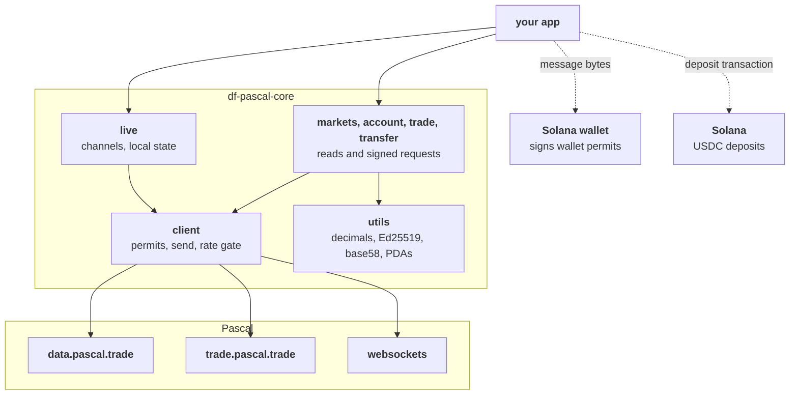

<p align="center">
  <a href="https://dfurrer.com">
    <picture>
      <source media="(prefers-color-scheme: dark)" srcset="https://dfu-cl-storybook.pages.dev/brand/markdfu-raised.svg">
      
    </picture>
  </a>
</p>

# df-pascal-core

Rust SDK for [Pascal](https://pascal.trade), the prediction market exchange on Solana: markets, books, trades, candles, accounts, history, orders, trading keys, deposits, withdrawals, referrals and websocket streams in one crate, with exact decimals, Ed25519 permits signed in Rust, and native or wasm transports.

## SDK

```text
df-pascal-core
├── client          the Client, deployments, signed writes, the rate gate
│   ├── http        the read and write APIs, the envelope, error codes, batches
│   ├── signed      Prepared and Signed requests, signed in process or by a wallet
│   ├── native      reqwest and tokio-tungstenite: Feed, OrderSocket (feature native)
│   └── web         fetch and WebSocket: Feed, OrderSocket (feature web)
├── markets         market data
│   ├── info        markets, specs, display attributes, stats, resolutions, search, text search
│   ├── book        order books
│   ├── candles     trade and mark price candles, batches
│   ├── trades      public trade history, the latest trades
│   ├── holders     the largest positions
│   └── system      server time, usernames, referral code lookup
├── account         account state, trading keys, history, profile
│   ├── state       collateral, orders, positions, pending transfers, rewards, lifetime volume
│   ├── keys        trading keys: list, check, create, revoke
│   ├── history     fills, transfers, resolutions, collateral returns, closed positions, PnL
│   ├── profile     username, bio, ranks, trader search, builder totals, taker discount
│   └── referrals   codes and referrals
├── trade           orders, cancels, collateral returns
│   ├── orders      limit, market, post-only, reduce-only, GTT, replaces, builder fees, batches
│   ├── cancel      by client or exchange id, batches, mass cancel
│   └── collateral  collateral returns on mutually exclusive events
├── transfer        deposits and withdrawals
│   ├── deposit     the deposit address, the USDC deposit transaction
│   └── withdraw    withdrawals to a wallet's USDC account
├── live            channels, frames, the session, local book, account and market state,
│                   the order entry protocol
└── utils           decimals, base58, keys, permits, ticks and fees, enums, Solana addresses,
                    program derived addresses, legacy transactions, JSON-RPC
```



## Signing

| Request | Signed by | Payload |
|---|---|---|
| Place, cancel, mass cancel, collateral return | trading key | 80-byte header and fixed binary body |
| Referral codes, username, bio | trading key | compact UTF-8 JSON array |
| Create and revoke trading keys, withdraw, register the deposit address | owner wallet | compact UTF-8 JSON array |

Every write is a `Prepared` request first: its body, its `auth`, and the exact bytes to sign. `Prepared::sign` signs with a key held in the program; `Prepared::with_signature` takes a wallet's signature and verifies it before the request can be sent.

```rust
use df_pascal_core::client::native::{Native, clock};
use df_pascal_core::trade::{self, OrderRequest};
use df_pascal_core::utils::Side;
use df_pascal_core::{Client, Dec, Keypair, Pubkey, Trader};

let owner = Pubkey::parse("GmaDrppBC7P5ARKV8g3djiwP89vz1jLK23V2GBjuAEGB")?;
let client = Client::new(Native::new(), clock, Trader::new(owner, Keypair::parse(&secret)?));
client.sync_clock().await?;
let order = OrderRequest::limit("SIM_EVENT_1.MARKET_1", Side::Bid, Dec::parse("0.55")?, 10, 42).post_only();
let placed = trade::place(&client, &order).await?;
```

## Examples

| Example | What it does |
|---|---|
| `cargo run -p df-pascal-core --example market_data` | Reads the busiest market's book, trades and hourly candles (or `-- SYMBOL`) |
| `cargo run -p df-pascal-core --example stream` | Keeps the busiest market's book from the websocket for 30 seconds and prints its trades |
| `cargo run -p df-pascal-core --example place_order -- SYMBOL` | Prints a signed post-only bid one tick under the best bid; `--send` places and cancels it |

The reference app is in [reference-app](reference-app): a Leptos frontend that uses every part of the SDK in a browser, deployed at https://df-pascal-web.pages.dev.

## Tests

```text
packages/core
├── src/**/tests    unit: every signing vector in Pascal's docs and the Python quickstart, the envelope,
│                   the client against a fake venue, ticks, fees, base58, keys, PDAs, transactions, frames
└── tests/live      read only, against production: every read and every channel decoded
```

| Command | What it runs |
|---|---|
| `just check` | format, lint, the browser transport for wasm, unit tests, the build without `sign`, docs, the reference app's lint |
| `just live` | the live suite against Pascal's production read API and market data socket |
| `just serve` | the reference app at http://localhost:5173 |
| `just deploy-app` | a release build of the reference app, deployed to Cloudflare Pages |

<br>

<p align="center">
  <sub><sub><a href="https://dfurrer.com">DFU</a></sub></sub>
  &emsp;&emsp;&emsp;
  <sub><a href="https://dfurrer.com">dfurrer.com</a></sub>
  &emsp;&emsp;&emsp;
  <sub><sub><a href="https://dfurrer.com">df.pascal</a></sub></sub>
</p>
